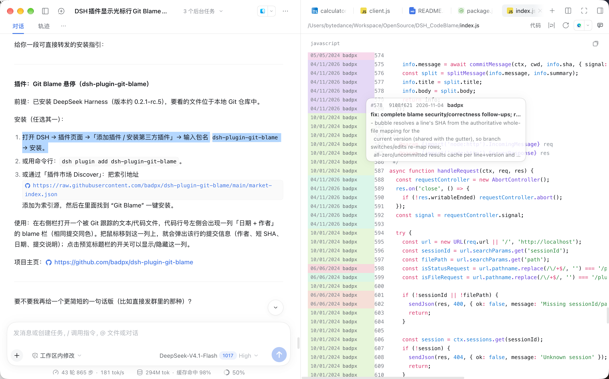

# Git Blame 悬停

[English](https://github.com/badpx/dsh-plugin-git-blame/blob/main/README.md) | 中文

一个 DeepSeek Harness 插件：在右侧栏的文件预览中打开文本或源码文件后，把鼠标悬停在某一行上，会显示一张小卡片，展示该行的 `git blame` 信息（作者、短提交哈希、日期和提交说明）。



## 安装

需要 DeepSeek Harness；本插件目标 DSH `^0.2.1-rc.5`。

- **从 npm 安装**：打开插件页面 →「添加插件 / Add plugin」，输入包名
  `dsh-plugin-git-blame`，或运行 `dsh plugin add dsh-plugin-git-blame`。
- **从本仓库（git）安装**：在同一对话框中粘贴仓库地址，或运行
  `dsh plugin add github:badpx/dsh-plugin-git-blame`。

### 可发现性（插件市场）

DSH 不会自行抓取 GitHub 或 npm。第三方插件通过实验性的**插件市场**呈现：
一个 *Discover* 标签页，读取你添加到设置中的**插件市场索引** JSON 文档 URL。
索引遵循 `@deepseek-ai/dsh-plugin-market-index` 的 format 1；其
`plugins[].versions[].source` 可以是 `{ "type": "npm" }`，也可以是指定完整
40 位十六进制提交的 git 条目：

```json
{
  "format": 1,
  "title": { "en": "My DSH plugins" },
  "plugins": [
    {
      "name": "dsh-plugin-git-blame",
      "title": { "en": "Git Blame" },
      "description": { "en": "Inline git blame gutter and hover bubble in the file preview." },
      "repository": { "url": "https://github.com/badpx/dsh-plugin-git-blame" },
      "icon": "https://raw.githubusercontent.com/badpx/dsh-plugin-git-blame/main/icon.svg",
      "versions": [
        {
          "version": "0.1.0",
          "publishTimestamp": 1740000000,
          "source": {
            "type": "git",
            "url": "https://github.com/badpx/dsh-plugin-git-blame",
            "commit": "<40-hex-commit-sha>"
          }
        }
      ]
    }
  ]
}
```

把索引托管在 https 上，并在 Discover/设置界面添加该 URL。本仓库自带一份现成的
[`market-index.json`](./market-index.json)；将其 raw 地址
`https://raw.githubusercontent.com/badpx/dsh-plugin-git-blame/main/market-index.json`
添加为索引源。发布到 npm 后，可以把版本切换为 `"source": { "type": "npm" }`
（安装器会构造精确的 `name@version`）。git 源会固定到具体提交，因此每次发版都要
刷新 `commit`。

## 工作原理

- **Host**（`index.js`）：注册 `GET /plugin/git-blame?sessionId=&path=&line=`。
  它会在 Session 的工作目录下解析文件，运行
  `git blame --line-porcelain -L <line>,<line> -- <file>`，并返回 JSON。
  只有 Session 工作目录内的文件才会被处理。
- **Client**（`client.js`）：注册 `shell.overlay` 的一个占位组件。指针移动监听器
  检测指针是否位于右侧栏 `[data-code-preview]` 或 `[data-textpreview-plain]`
  中的某一行，把悬停的标签页映射到其 `dsh-resource://file/...` 地址，并向 Host
  路由请求该行的 blame。

预览标题栏中的开关按钮可以开启/关闭内联 blame 列，并记住选择。开关和该列只对
**文本且被 Git 跟踪**的文件出现；未跟踪或二进制文件两者都不显示。

## 内联 blame 列

对于内置的高亮代码预览，插件会在行号左侧注入一个固定宽度的 gutter 列。每行显示
`日期 + 作者`（过长省略），并按提交 SHA 着色，因此同一提交共享同一种颜色。把鼠标
移到该列上会显示 blame 气泡；悬停在代码行本身上则不显示。

注册了一个快捷键命令 **"显示/关闭 Git Blame 气泡"**，但默认未绑定；可在
设置 → 快捷键 中为其分配按键，当前键帽会显示在开关的 Tooltip 中。

## 说明

- 预览是只读的，因此交互使用鼠标指针而不是文本光标。
- 悬停在 blame gutter 列上会立即显示气泡；离开该列立即隐藏。
- 气泡跟随在光标下方。当靠近窗口底部空间不足时，会翻转到光标上方，并保持相同间距。
- 卡片略微半透明（不透明度 0.85）。约 9 秒没有指针移动后，会在 1 秒内淡到 0.15，
  避免遮挡下方代码；任何指针移动都会恢复。
- 提交信息以加粗的首行标题 + 普通正文显示；正文最多 5 行，超出时以省略号结尾。
  当提交只有单行信息时，该行会换行并使用完整的 5 行预算，而不是被限制为一行。
- blame 按「文件 + 提交」共享：同一提交的连续多行复用同一条缓存，因此在这些行之间
  移动指针是即时的，不会重新加载。未提交的行仍按行缓存。

## 缓存

- **整文件 blame 缓存（`gutterCache`）**：一个内存 LRU，键为
  `文件地址 + 快照版本`，保存 gutter 渲染所需的逐行数组。受 **64 MB 字节预算、
  最多 200 条**限制；单文件行数据超过 16 MB 时不缓存；淘汰最久未使用的条目
  （不会整表清空）。同一文件+版本的并发读取会合并为一次请求，气泡会复用侧栏
  已持有的映射——因此即使文件大到无法缓存，也不会在每次悬停时重新获取 blame。
- **客户端气泡缓存**：有界 LRU（2000 条，600 秒 TTL）。已提交行以
  `文件地址 + 提交 SHA` 为键，因此同一提交的每一行共享一条缓存，跨行移动指针
  即时完成（不重新加载）。未提交行以 `文件地址 + 内容版本 + 行号` 为键。快照版本
  为一次安全打开得到的 `HEAD + 文件大小 + mtime + ctime`（约 1 秒内复用），宿主
  会确认读取与 blame 之间 HEAD 未变化，因此切分支或编辑会把每行映射到正确提交，
  绝不返回过期 blame——且无需在每次探测时哈希整个文件。
- **宿主提交说明缓存**：按完整提交 SHA 为键，500 条 LRU。失败不会被缓存，因此
  临时的 `git show` 错误会重试。
- 不在 Git 仓库中的文件，或未被跟踪的行，会显示一条简短说明而不是提交信息。
